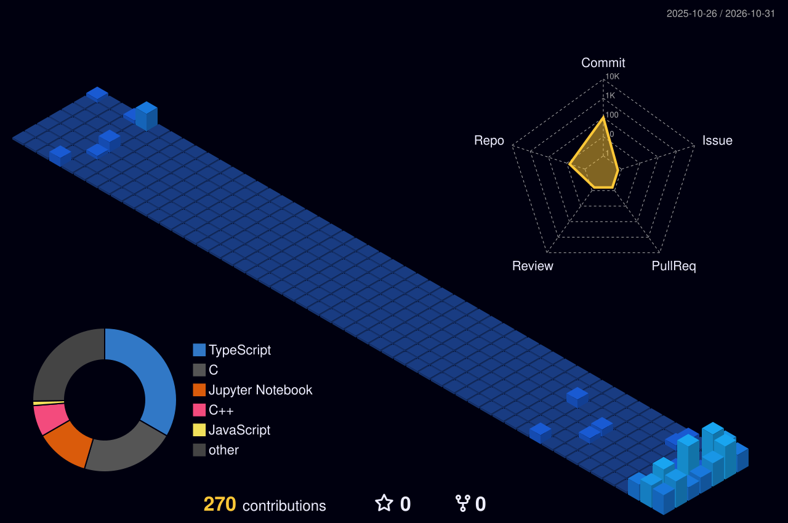

# Naresh Kumar

 

 

## 👋 About Me

Data Science undergraduate at **FAST-NUCES Karachi** passionate about turning raw data into actionable intelligence. I build **machine learning pipelines**, **interactive analytics dashboards**, and immersive **3D web interfaces**, backed by continuous practice in **algorithms and data structures**.

| 🎓 Studying | 🛠️ Building | 🧠 Exploring | 🏁 Practicing |
|:---:|:---:|:---:|:---:|
| BS Data Science @ FAST-NUCES | ML models & predictive dashboards | Deep Learning & Time-Series | Algorithms & Problem Solving |

 

## 🚀 Featured Projects

<table>
<tr>
<td width="50%" valign="top">

### 🌌 [Cosmos: 3D Data Science Portfolio](https://nareshkumar17.netlify.app/)
An immersive, cosmic 3D developer portfolio powered by Three.js and Framer Motion, connecting data science projects and web artistry.

</td>
<td width="50%" valign="top">

### 🌤️ [Karachi Air Quality Forecasting](https://github.com/Naresh-Kumar17/Air_Quality_Forcasating-)
Real-time air quality forecasting for Karachi using SARIMA & Isolation Forest, featuring an interactive live Streamlit dashboard.

</td>
</tr>
<tr>
<td width="50%" valign="top">

### 🚗 [Road Accident Severity Prediction](https://github.com/Naresh-Kumar17/Road-Accident-Severity)
Exploratory data analysis and predictive classification on UK road accident datasets to predict and evaluate injury severity.

</td>
<td width="50%" valign="top">

### ✍️ [SVM Handwritten Digits Classifier](https://github.com/Naresh-Kumar17/svm-handwritten-digits)
Handwritten digit recognition model trained using Support Vector Machines with an interactive drawing canvas for real-time predictions.

</td>
</tr>
<tr>
<td width="50%" valign="top">

### 🏦 [Bank Management System](https://github.com/Naresh-Kumar17/Bank-Management-System-C-Raylib)
High-performance banking system implemented in C featuring custom data structures and an interactive graphical UI powered by Raylib.

</td>
<td width="50%" valign="top">

### 🏏 [Cricket Match Management System](https://github.com/Naresh-Kumar17/Cricket-Match-Management-System)
Object-oriented simulation and tracking system for live cricket match scorecards and player career statistics.

</td>
</tr>
</table>

 

## 🧰 Tech Stack

**Languages**

  

**Data Science, Machine Learning & Frameworks**

  

**Tools, Databases & Platforms**

 

## 📊 GitHub Analytics

 

## 🧊 3D Contribution Graph

 

Live isometric 3D visualization of coding contributions, updated daily.

 

## 🌐 Let's Connect

I'm open to collaborations on Data Science, Machine Learning, and innovative software projects. Reach out anytime!

 

